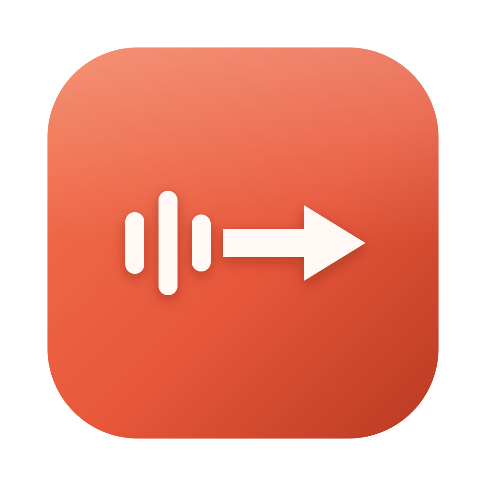

<div align="center">



# Sayvane

**Speak where you type.** Private, on-device voice dictation for macOS and Windows.


</div>

---

Put your cursor in any text field, hold a key, and talk. Sayvane transcribes your voice
**on your own computer** and types the result where you were writing. It never presses
Enter for you, and every recording and transcript stays in a local, searchable History.

## Why Sayvane

Typing is the bottleneck for most of what we write: messages, notes, docs, prompts.
Voice is three to four times faster, but most dictation tools send your audio to someone
else's server, need an account, or only work inside their own window.

Sayvane is built on a few simple promises:

- **Your voice never leaves your computer.** Recognition runs locally and works offline
  once a model is installed. No account, no subscription, no backend.
- **It works in every app.** Slack, Mail, VS Code, your browser: wherever the cursor is.
- **Nothing is lost.** Every recording is saved before anything else happens, so a crash,
  a closed laptop, or a failed AI request never costs you what you said.
- **AI is optional and yours to choose.** Turn on polishing to clean up filler words and
  punctuation through a provider *you* pick (OpenRouter, any OpenAI-compatible API, or a
  model running on your own machine). It is off by default.

## Features

| | |
| --- | --- |
| 🎙️ **Hold-to-talk & hands-free** | Hold <kbd>fn</kbd> (Mac) or <kbd>Ctrl</kbd>+<kbd>Alt</kbd>+<kbd>Space</kbd> (Windows) to talk; double-tap for hands-free. All shortcuts are configurable. |
| 🫧 **Floating bar** | A small capsule above the Dock/taskbar with a live waveform. It never steals focus from the app you're typing in. |
| 🔒 **Local recognition** | Five model sizes, from 78 MB to 1.6 GB, all verified by SHA-256 before use. |
| ✨ **Optional AI polish** | Removes filler and repetition, fixes grammar and punctuation. Never summarizes or answers. |
| 🗂️ **History** | Search, copy, recover, retry, compare the original and polished text, and export TXT, JSON, SRT, VTT or TSV. |
| 📁 **File transcription** | Import WAV, MP3, M4A, FLAC or OGG files and get timed subtitles. |
| 🛡️ **Safe insertion** | Refuses password fields, pauses if you switch apps, pastes at most once, and puts your old clipboard back. |

## Quick start

### Use the app

Download the installer for your computer from
[Releases](https://github.com/Arunkumar-MS/sayvane/releases), then:

1. Open Sayvane and click **Install** on the **Balanced** model (148 MB, one time).
2. Allow the microphone when asked.
3. **Mac:** turn Sayvane on in System Settings › Privacy & Security › Accessibility, so it
   can type into other apps. Set System Settings › Keyboard › "Press 🌐 key to" to
   **Do Nothing**, so <kbd>fn</kbd> is free for dictation.
4. Click into any text field, hold the shortcut, speak, and let go.

> Development builds are not yet signed with an Apple Developer ID. If macOS blocks the
> app on first launch, right-click it and choose **Open**. After installing a newer build,
> use **Settings › Privacy › Reset access** if permissions show "Not allowed".

### Run from source

**Prerequisites**

| Tool | Version | Notes |
| --- | --- | --- |
| Node.js | 22+ | with [pnpm](https://pnpm.io) 10 |
| Rust | 1.89+ | install via [rustup](https://rustup.rs) |
| CMake | 3.21+ | builds the speech engine |
| Platform tools | — | macOS: Xcode Command Line Tools · Windows: Visual Studio 2022 Build Tools (C++), WebView2 |

**Build and run**

```bash
git clone https://github.com/Arunkumar-MS/sayvane.git
cd sayvane
pnpm install

# 1. Build the bundled speech engine for your machine (one time, about 2–5 minutes)
scripts/build-worker.sh                 # macOS (Apple Silicon or Intel)
# pwsh scripts/build-worker.ps1         # Windows

# 2. Launch the app with hot reload
MACOSX_DEPLOYMENT_TARGET=13.0 pnpm tauri dev
```

Working on the UI only? `pnpm dev:mock` runs the interface in your browser against a fake
backend, with no Rust or speech engine needed.

**Build an installer**

```bash
pnpm tauri build --bundles app,dmg      # macOS → src-tauri/target/release/bundle/dmg/
pnpm tauri build --bundles nsis         # Windows → src-tauri/target/release/bundle/nsis/
```

## Choosing and changing the speech model

Pick a model any time in **Settings › Dictation › Speech model**. Sayvane keeps one model
loaded between dictations, and your choice applies to the next recording.

| Model | ID | Size | Languages | Translate to English | Suggested memory |
| --- | --- | --- | --- | --- | --- |
| Fastest | `tiny` | 78 MB | 99 languages | ✅ | 2 GB |
| **Balanced** (default) | `base` | 148 MB | 99 languages | ✅ | 4 GB |
| More accurate | `small` | 488 MB | 99 languages | ✅ | 8 GB |
| High accuracy | `large-v3-turbo` | 1.6 GB | 99 languages | — | 16 GB |
| English fast | `tiny.en` | 78 MB | English | — | 2 GB |

**Offline machines:** download the `.bin` file elsewhere, then use **Import model file**.
Sayvane checks it against the published SHA-256 before using it.

**Adding a model:** models are listed in [`models/manifest.json`](models/manifest.json).
Add an entry with the file's `url`, exact `sizeBytes` and `sha256` (from the Hugging Face
file page), then rebuild. Downloads that don't match the manifest are rejected, so never
leave the hash out.

Other recognition options, such as language, translation, vocabulary hints, beam search
and threads, are under **Settings › Dictation › Advanced**.

## AI polishing (optional)

Off by default. With it off, no transcript text ever leaves your computer. To turn it on,
open **Settings › AI Polish**, add a provider, save its key, and pick a model:

| Provider | Base URL | Notes |
| --- | --- | --- |
| OpenRouter | `https://openrouter.ai/api/v1` | Hundreds of models, one key |
| Any OpenAI-compatible API | your URL | Bearer key or custom headers |
| Organization gateway | your URL | Uses your system's certificate trust |
| Local server (Ollama, LM Studio…) | `http://127.0.0.1:11434/v1` | No cloud account needed |

Keys are stored in the macOS Keychain or Windows Credential Manager, never in files.
Only the current transcript is sent: no audio, no History, no app names. If the provider
fails or times out (15 s), your original text is used and nothing is lost.

## How it works

```
 hotkey / floating bar
          │
          ▼
 ┌─────────────────┐   16 kHz WAV   ┌───────────────────┐
 │  Rust core      │ ─────────────▶ │  Speech worker    │   on-device C++,
 │  session state  │ ◀───────────── │  (bundled)        │   CPU · Metal
 │  audio capture  │   transcript   └───────────────────┘
 │  SQLite History │
 │                 │ ── optional ──▶ AI provider of your choice
 │                 │
 │                 │ ──────────────▶ paste into the focused app
 └─────────────────┘                 (Accessibility / UI Automation)
          ▲
          │ typed IPC commands & events
 ┌─────────────────┐
 │ React interface │  Home · History · Settings · floating bar
 └─────────────────┘
```

Every step is saved before the next one starts: the recording, then the original
transcript, then the polished text, and only then the paste. A single coordinator owns the
session, and stale results from a canceled recording are discarded before they can touch
your clipboard or another app.

## Tech stack

| Layer | Technology |
| --- | --- |
| Desktop shell | [Tauri 2](https://tauri.app) |
| Interface | React 19, TypeScript, Vite, plain CSS with design tokens, [Lucide](https://lucide.dev) icons |
| Core | Rust: cpal (CoreAudio/WASAPI), rusqlite, reqwest, symphonia, keyring |
| Speech engine | C++ worker on [whisper.cpp](https://github.com/ggml-org/whisper.cpp) 1.9.5 (Metal on Apple Silicon, CPU elsewhere) |
| macOS integration | Accessibility API, CGEvent tap, NSPasteboard, NSPanel |
| Windows integration | UI Automation, SendInput, Win32 clipboard |
| Storage | SQLite (WAL) with versioned migrations, atomic file writes |
| CI | GitHub Actions on native runners for Apple Silicon, Intel Mac and Windows x64 |

## Project layout

```
branding/         Product name, colors and icon: rename the app here
ui/src/           React interface (pages, components, state, typed IPC)
src-tauri/src/    Rust core
  session.rs        dictation state machine
  insertion.rs      safe paste procedure shared by all platforms
  platform/         macOS and Windows adapters
  speech/           speech-worker client and verified model manager
  providers.rs      optional AI polishing
speech-worker/    C++ recognition worker and its JSON protocol
models/           model manifest (URLs, sizes, SHA-256)
docs/             development, release and compatibility notes
```

## Testing

```bash
pnpm test                                   # interface unit tests
cd src-tauri && cargo test                  # core: gestures, storage, exports, insertion safety…
SAYVANE_TEST_MODEL=/path/to/ggml-tiny.en.bin cargo test   # adds real speech recognition
```

## Make it your own

The product name, colors and icon live in one place. Edit
[`branding/brand.json`](branding/brand.json) and `branding/icon.svg`, then run:

```bash
node scripts/generate-branding/index.mjs --icons
```

Window titles, tray menus, permission prompts and installers all update. Keep
`applicationId` unchanged once you've shipped, because it identifies your users' data and
saved keys.

## Status

| Platform | Status |
| --- | --- |
| macOS Intel | ✅ Builds, runs, tested on real hardware |
| macOS Apple Silicon | 🟡 Built by CI on every push; needs hands-on testing |
| Windows x64 | 🟡 Built by CI on every push; needs hands-on testing |

See [`docs/compatibility.md`](docs/compatibility.md) for the full test matrix. Hands-on
reports from Apple Silicon and Windows users are especially welcome.

## Contributing

Contributions of every size are welcome: bug reports, testing on your hardware,
translations, design polish and code. Start with
[CONTRIBUTING.md](CONTRIBUTING.md), which covers setup, the areas that need help, and how
to send a pull request.

## License

[MIT](LICENSE) © 2026 Sayvane contributors.

Sayvane builds on excellent open-source work, including
[whisper.cpp](https://github.com/ggml-org/whisper.cpp) and OpenAI's open speech model
weights (both MIT). Full credits are in
[THIRD_PARTY_NOTICES.md](THIRD_PARTY_NOTICES.md). Sayvane is an independent project, not
affiliated with or endorsed by OpenAI or the ggml project.
